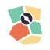

# Tool logos

One mark for each Project Sidewalk tool: **AccessScore**, **Gallery**, **Label Map** and **Reports**. The four are
drawn as one family from the Project Sidewalk v2 logo's four colors and its wheel. They were designed and picked in
[SidewalkWebpage#5958](https://github.com/ProjectSidewalk/SidewalkWebpage/issues/5958) (November 2026) and first
shipped in [SidewalkWebpage#5965](https://github.com/ProjectSidewalk/SidewalkWebpage/pull/5965), where each one
heads its tool's left sidebar.

| AccessScore | Gallery | Label Map | Reports |
|:---:|:---:|:---:|:---:|
|  |  |  |  |
| **A26**: a patchwork of five neighborhoods colored by score, with the logo's wheel where they meet | **G19**: two stacked photo frames showing a sidewalk on green ground, with an orange label pin | **L0**: a folded map with an asphalt pin | **R12**: a tri-fold with the logo's wheel, a chart and a findings list on its panels |

## Files

- `Final/*.svg`: the masters, hand-optimised and drawn on a 64-unit grid (`viewBox="0 0 64 64"`). These are
  byte-identical to `public/images/logos/tools/` in SidewalkWebpage, which is what the site serves.
- `Final/PNG/`: square exports at 16, 32, 64, 256 and 1024 px with transparent backgrounds, rendered from the SVGs
  with resvg. Regenerate them from the SVGs if a master changes.

## Usage

- **Pair a mark with its tool's name** in Raleway ExtraBold. On the website that lockup is one component
  (`@common.toolHeader`), documented in SidewalkWebpage's `docs/style-guide.md` under "Tool logos".
- **"AccessScore" is a wordmark** and is never translated. "Gallery", "Label Map" and "Reports" are ordinary words and
  are translated.
- **These marks are drawn for light backgrounds.** On asphalt the white outlines keep all four readable, but Gallery's
  frames and the other asphalt parts merge into the background. No dark variant exists yet; draw one before a mark
  goes on a dark surface.

## Colors

| Role | Hex |
|---|---|
| Asphalt | `#2D2A3F` |
| Green | `#78C8AA` |
| Yellow | `#FAD68A` |
| Orange | `#EA734D` |

Three of these values differ slightly from the palette in this repo's top-level README, and the greens are visibly
different. See [Design#5](https://github.com/ProjectSidewalk/Design/issues/5).

## Design process

The exploration ran in twelve rounds, with about 36 first ideas (coded A0–A8, G0–G8, L0–L8 and R0–R8) and then
riffs on the ones shortlisted. The issue records rounds 1 to 7 and the reasoning behind each pick:

1. **Directions**: three family systems (a three-part mark, a mark on the logo's fan, a tile).
2. **Ideas**: nine divergent ideas per tool.
3. **Riffs on picks**: A9–A12, G9–G12, R9–R12.
4. **Shortlist**: bolder versions of G9 (G13–G16), checked down to 16 px.
5. **Frames and AccessScore**: thinner Gallery frames (G17–G19); AccessScore built from parts of the logo
   (A13–A18).
6. **AccessScore patchwork**: neighborhood patchworks (A19–A24); A8 with the wheel at the logo's circle size
   (A25, A26).
7. **Gallery pin color**: orange versus asphalt pin (G20, G21).

Rounds 8 to 12 are not in the issue. They came after A26 was tried in the real sidebar and looked for an AccessScore
mark built from a scored street network instead. A26 was kept on 11 November 2026, so none of these marks shipped:

8. **AccessScore network**: A2's scored streets with a start and a destination (A27–A32).
9. **AccessScore web**: webs of streets around the wheel (A33–A38).
10. **A2 and A27, grown**: more streets, with the wheel as origin and a pin as destination (A39–A44).
11. **Shortlist in the app**: A26, A41 and A42 in screenshots of the real sidebar, and heavier versions of the
    last two (A45, A46).
12. **Other kinds of network**: eight more networks (A47–A54), and two of them with a dot on every node (A55, A56).

The rounds were drawn on a design canvas outside GitHub. `Ideation/` archives them, one contact sheet per round:

- [`round-1-directions.png`](Ideation/round-1-directions.png)
- [`round-2-ideas.png`](Ideation/round-2-ideas.png)
- [`round-3-riffs-on-picks.png`](Ideation/round-3-riffs-on-picks.png)
- [`round-4-shortlist.png`](Ideation/round-4-shortlist.png)
- [`round-5-frames-and-accessscore.png`](Ideation/round-5-frames-and-accessscore.png)
- [`round-6-accessscore-patchwork.png`](Ideation/round-6-accessscore-patchwork.png)
- [`round-7-gallery-pin-color.png`](Ideation/round-7-gallery-pin-color.png)
- [`round-8-accessscore-network.png`](Ideation/round-8-accessscore-network.png)
- [`round-9-accessscore-web.png`](Ideation/round-9-accessscore-web.png)
- [`round-10-a2-and-a27-grown.png`](Ideation/round-10-a2-and-a27-grown.png)
- [`round-11-shortlist-in-the-app.png`](Ideation/round-11-shortlist-in-the-app.png)
- [`round-12-other-kinds-of-network.png`](Ideation/round-12-other-kinds-of-network.png)

Each sheet lays out that round's artboards as they sat on the canvas, rendered at 2x. Some boards (round 1's
family overview and the sidebar boards) could swap candidates on the canvas; the sheets show the candidates each
board opened on.

`Ideation/svg/` holds every idea's drawing as it was on the canvas, named by its code (`A0.svg` to `A56.svg`,
`G0.svg` to `G21.svg`, `L0.svg` to `L8.svg`, `R0.svg` to `R12.svg`). These are working drawings, not optimised; the
masters are in `Final/`. A41, A42, A45 and A46 were withdrawn and have no file. Round 1's Direction 1 marks are A0,
G0, L0 and R0. Its Direction 2 and 3 marks were never given codes and are saved as `direction-2-<tool>.svg` and
`direction-3-<tool>.svg`.
