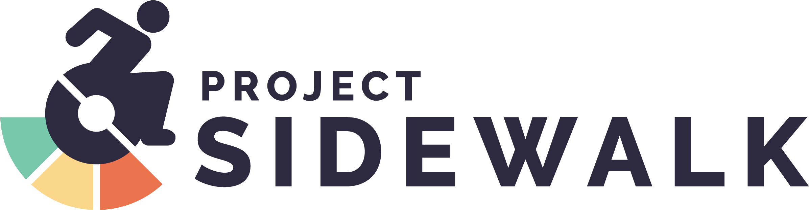
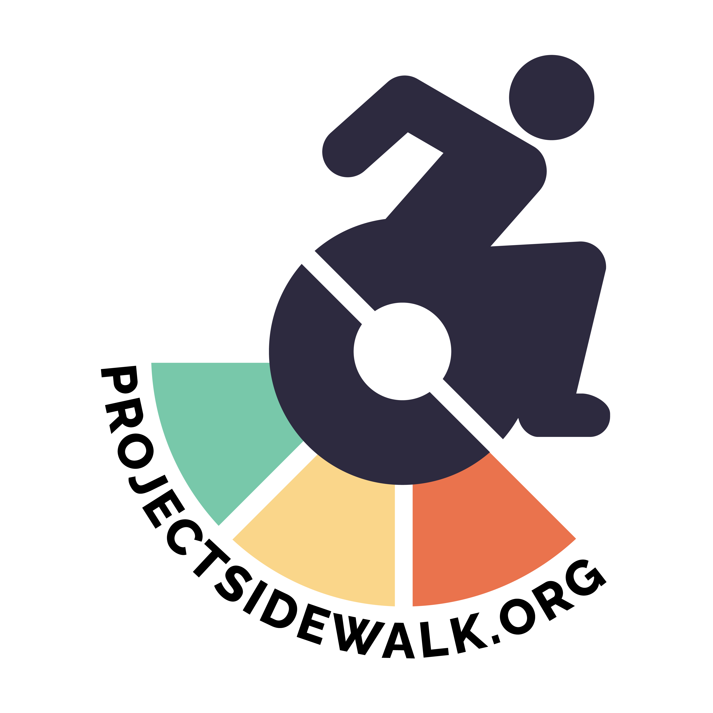
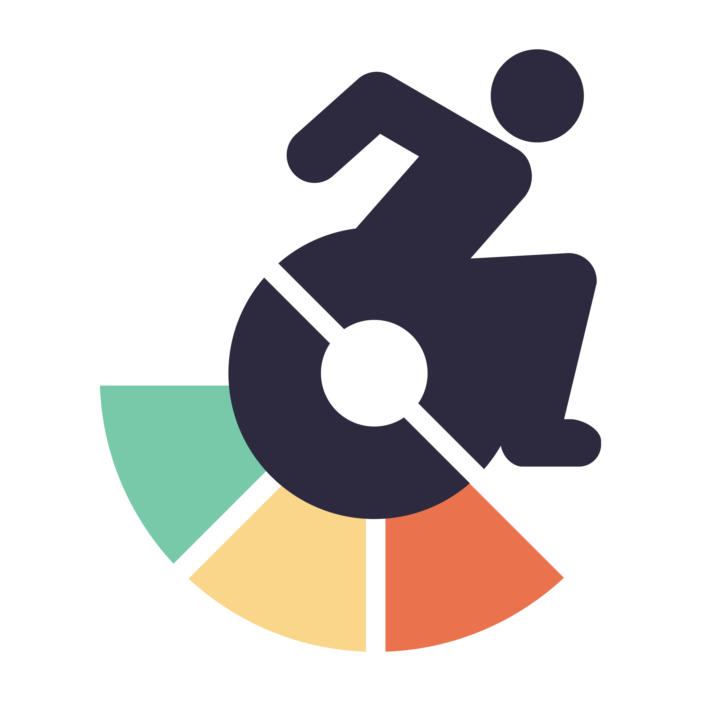
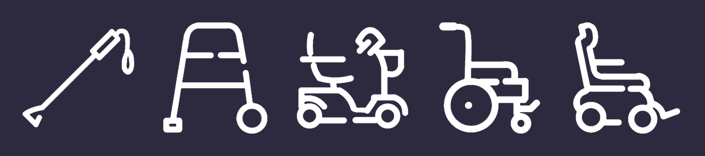

# Overview

This is the Project Sidewalk repo for design assets.

# Design Principles
**User education:** how can we continuously help users learn about urban design and accessibility assessment. Relatedly, how can we help them become more effective labelers. One great example of this is the [mission screen redesigns](https://github.com/ProjectSidewalk/SidewalkWebpage/issues/3242) but another is feedback—how can users get timely feedback on their performance so they can take corrective action. See [Section 1.1.2 of Jon's PhD dissertation](https://makeabilitylab.cs.washington.edu/media/publications/Sensing_and_Feedback_of_Everyday_Activities_to_Promote_Environmental_Behaviors_Eye7nYF.pdf).

**Collective action:** how can we help people feel part of something bigger than themselves. For example, the sidebar should not just track my progress in a neighborhood but the overall progress of our collective efforts together. Being part of a community is a human need, and the best way to make a difference.

**Fun, motivation, engagement.** how can we make the experience feel fun and engaging. What are current pain points (one you identified is the "overwhelm" that users might feel in starting or feelings of "anxiety" when they don't know how to label something). Sometimes, little UI tweaks (like animations) can help make an experience feel more cohesive and fun.

**Making a difference.** how can/should we remind people of how their work can make a difference? How can we show the power of the data and its potential for diverse applications?

**Human presence.** How can we better imbue the interface with feelings of empathy and that this task is fundamentally about helping people and improving cities. It would just be nice to have more human presence in the UX. This relates to: [#3083](https://github.com/ProjectSidewalk/SidewalkWebpage/issues/3083)

# Color Palette

## Project Sidewalk Icon

The hex codes are the 500 level of each color in our design-system tokens, which SidewalkWebpage serves in `frontend/css/main.css` ([Design#5](https://github.com/ProjectSidewalk/Design/issues/5)). The Pantone numbers are from the original brand guide, [PS_brand_guidelines.pdf](PS_brand_guidelines.pdf) (2017), whose hex codes differ from the tokens by at most two units per channel, too little to see.

| Color Name | Token | Hex Code | Pantone |
| :--- | :--- | :--- | :--- |
| **Hero Color** (navy) | `--color-asphalt-500` | `#2D2A3F` | 5255 |
| Orange | `--color-orange-500` | `#EB724E` | 7417 |
| Yellow | `--color-banana-500` | `#FBD98C` | 7403 |
| Green | `--color-pine-500` | `#78C9AB` | 7472 |
| Gray | (none) | `#DCDBDB` | 435 |

## Labeling Buttons
 #ED1C24 | Alert 
 #90C31F | Curb Ramp Label 
 #E679B6 | Missing Curb Ramp 
 #78B0EA | Obstacle 
 #F68D3E | Surface Problem 
 #BE87D8 | Missing Sidewalk 
 #63C0AB | Pedestrian Signal 
 #FABF1C | Crosswalk 
 #B3B3B3 | Other 
 #2D2A3F | Black 
 #FFFFF | White 

# Logos
We have two primary logo forms: the landscape logo and the circular logo. Each comes in full color and in six single colors.

## Landscape logo

## Circular logo
The circular logo comes with curved text, with horizontal text below it, or with no text.

## Where the files are
The v2 logos are in [Logos/Logo_Horizontal/v2](Logos/Logo_Horizontal/v2) and [Logos/Logo_Square/RGB/v2](Logos/Logo_Square/RGB/v2):

- `*.ai`: the Illustrator masters.
- `<name>.svg` and `<name>_<width>x<height>.png`: full color.
- `Monochrome/<Color>/<name>_<Color>.svg` and `.png`: single color, in White, Black, Navy, Orange, Yellow and Green.

In the single-color versions, a thin transparent gap separates the wheel from the sidewalk below it, so the wheel still reads as a circle.

Every SVG and every single-color PNG is generated from the `.ai` masters by [Logos/build_v2_logos.py](Logos/build_v2_logos.py). After you change a master, rerun the script instead of editing the outputs by hand.

## Which single color to use
Use the full-color logo whenever you can. When you need a single color, pick one by background:

| Single color | Use it on | Contrast |
| :--- | :--- | :--- |
| Navy | White or light backgrounds. It's the preferred single color, and the brand guide's choice for screen printing. | 13.9:1 on white |
| Black | Light backgrounds, when navy isn't possible. | 21:1 on white |
| White | Navy, dark backgrounds or photos. | 13.9:1 on navy |
| Orange | Light backgrounds, at large sizes only. | 3.0:1 on white |
| Yellow | Navy or black backgrounds only. It nearly disappears on white. | 10.2:1 on navy |
| Green | Navy or black backgrounds only. | 7.1:1 on navy |

## Tool logos
Each tool (AccessScore, Gallery, Label Map and Reports) has its own mark, drawn as one family from the logo's colors and wheel. The SVG masters, PNG exports and the design notes are in [Logos/Logo_SidewalkTools](Logos/Logo_SidewalkTools).

   

# Mobility-aid icons
Five icons for the mobility aids in our research on personalized accessibility maps: walking cane, walker, mobility scooter, manual wheelchair and motorized wheelchair. [Chu Li](https://makeabilitylab.cs.washington.edu/member/chuli/) designed them for her CHI 2025 paper, [Accessibility for Whom?](https://doi.org/10.1145/3706598.3713421) The single-color PNGs (white and navy), the credit and license, and how to recolor them are in [Icons/MobilityAids](Icons/MobilityAids).

# Acknowledgments
Original logos and branding vision by the amazing [Rachael Marr](https://www.rachaelmarr.com/). 

Project Sidewalk's original UI was designed and developed by [Kotaro Hara](https://kotarohara.com/) and Jon E. Froehlich as part of Kotaro's [PhD dissertation](https://makeabilitylab.cs.washington.edu/media/publications/Hara_ScalableMethodsToCollectAndVisualizeSidewalkAccessibilityDataForPeopleWithMobilityImpairments_2016.pdf)

The new labeling buttons and color palette (introduced in 2021) were designed by the marvelous MHCI+D student [Duanhao Zhang](https://www.linkedin.com/in/danieldhzhang/)

The mobility-aid icons were designed by [Chu Li](https://makeabilitylab.cs.washington.edu/member/chuli/) for her CHI 2025 paper, [Accessibility for Whom?](https://doi.org/10.1145/3706598.3713421), which is licensed under CC BY 4.0. The versions in [Icons/MobilityAids](Icons/MobilityAids) are adapted from the paper's Figure 1.

Others have since contributed on re-mixing logos for city-specific deployments including Liga Peatonal for Mexico-based deployments
